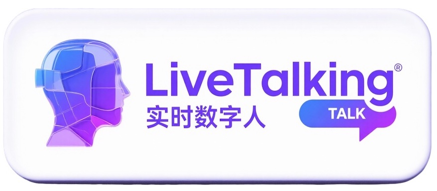

# KnowTalk · Real-time Interactive Digital Human Micro-course System

[中文版（权威版本）](./README.md) | English

> **Documentation status / 文档状态**
>
> This English page is **not** a full translation of [README.md](./README.md). It is a short,
> accurate entry point. When the two disagree, the Chinese version and the OpenSpec
> capability specs are authoritative.
>
> 本英文页**不是** [README.md](./README.md) 的完整翻译，只是一页准确的入口说明；两者不一致时，
> 以中文版与 OpenSpec 能力规格为准。完整英文翻译尚待补做（已登记为后续变更）。

    
    
    

**KnowTalk** is a real-time interactive streaming digital human system for micro-course
teaching, built as a secondary development of the open-source
[KnowTalking](https://github.com/lipku/KnowTalking) project (Apache 2.0). It gives a
teacher a digital human assistant that can speak, answer questions, and turn slides.

## Capabilities

| Capability | Description |
|---|---|
| Digital human models | `wav2lip` / `musetalk` / `ultralight` lip-sync backends, custom avatars |
| TTS engines | EdgeTTS (default) plus CosyVoice / Tencent / Doubao / FishTTS / GPT-SoVITS and other plugins |
| Chat LLM | DeepSeek streaming dialogue with per-session multi-turn memory (default last 10 rounds) |
| RAG course knowledge base | PDF upload → parsing/chunking → embedding → hybrid retrieval → rerank → answers with citations, isolated per course |
| Slide following | PPT upload converted to slide images; keyword matching and `[PPT:N]` tags drive slide switching |
| Teaching aids | Live captions, Q&A record export, course switcher |
| Voice cloning | Upload a reference audio sample to clone a voice |
| Outputs | WebRTC (low latency) / RTMP (platform push) / virtual camera |
| Interruption | The digital human can be interrupted while speaking |
| Admin console | Session monitoring, configuration, knowledge base, PPT library, avatar management |

## Quick start

See [README.md](./README.md#-快速开始windows) for the full, current instructions
(Windows desktop launcher `start_app.bat`, manual startup, RAG sidecar environment, model
preparation). The backend listens on port **8010** by default.

## Where the documentation lives

| What you need | Where to look |
|---|---|
| Documentation index (install, run, troubleshooting, design notes) | [docs/README.md](./docs/README.md) |
| API contracts — parameters, responses, error conditions | OpenSpec capability specs under `openspec/specs/` (see [README.md](./README.md#-文档导航)) |
| Deploying and debugging the RAG service | [rag_service/README.md](./rag_service/README.md) |

Normative content lives in the OpenSpec capability specs; the READMEs and `docs/`
are entry points and operating guides only. A change with no capability specs is
expected to produce no spec delta.

## Upstream and license

This project is a secondary development of [lipku/KnowTalking](https://github.com/lipku/KnowTalking),
licensed under the Apache License 2.0; the upstream copyright notice is retained in
[LICENSE](./LICENSE). Feature descriptions and demo links that belong to the upstream
project are intentionally **not** reproduced here, because they do not describe this
repository. For upstream material, see the upstream repository.
