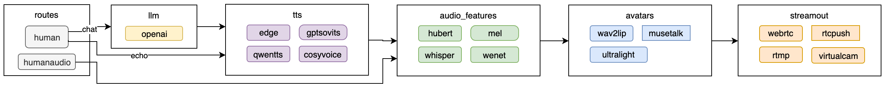
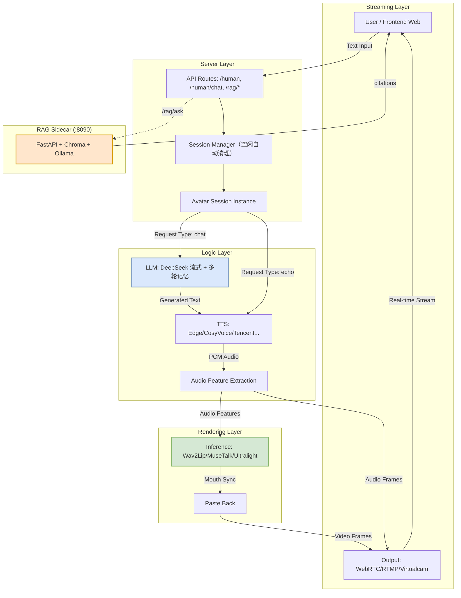

# KnowTalk 知课 · 实时交互数字人微课系统

[English](./README-EN.md)（内容尚未与中文版同步，详见其开头的状态说明） | 中文版

<p align="center">

</p>

<p align="center">
    <a href="./LICENSE"></a>
    <a href=""></a>
    <a href=""></a>
    <a href="https://github.com/lipku/KnowTalking/releases"></a>
</p>

> **KnowTalk（知课）** 是基于开源项目 [KnowTalking](https://github.com/lipku/KnowTalking)（原 metahuman-stream）二次开发的**实时交互流式数字人系统**，面向微课教学场景。它让老师拥有一个会说话、能答疑、随 PPT 自动翻页的数字人助教。

---

## ✨ 特性总览

| 能力 | 说明 |
|---|---|
| 🎭 **多模型数字人** | wav2lip / musetalk / ultralight 三种口型驱动，支持自定义形象 |
| 🎤 **多 TTS 引擎** | EdgeTTS（默认）/ CosyVoice / Tencent / Doubao / FishTTS / GPT-SoVITS 等插件化接入 |
| 🧠 **Chat LLM 自由问答** | DeepSeek 流式对话，支持**多轮上下文记忆**（最近 10 轮，可调） |
| 📚 **RAG 课程知识库** | PDF 上传→索引→混合检索→重排→带引用溯源回答，按课程隔离 |
| 📊 **PPT 课件联动** | 上传 PPT 自动转图，关键词匹配 + `[PPT:N]` 标签自动翻页 |
| 💬 **教学问答增强** | 实时字幕、问答记录导出、课程切换面板 |
| 🔊 **声音克隆** | 上传参考音频即可克隆音色 |
| 📡 **多路输出** | WebRTC（低延迟）/ RTMP（平台推流）/ 虚拟摄像头 |
| ⏸️ **打断机制** | 数字人说话可随时打断，支持续播 |
| 🛠️ **管理后台** | 会话监控、配置管理、知识库维护、PPT 库、Avatar 管理 |

---

## 🚀 快速开始（Windows）

### 方式一：一键启动（推荐）

```bat
start_app.bat
```

脚本自动完成：检查 Python 与依赖 → 启动主服务（模型加载约 1-2 分钟）→ 打开原生桌面窗口。

桌面版为原生 Windows 窗口（Tkinter），不依赖浏览器；主服务作为其后端自动启动，登录后即可使用数字人。

### 2. 手动启动

```bash
# 1. 安装依赖
pip install -r requirements.txt
# RAG 知识库问答（可选但推荐）使用独立环境：
python -m venv .venv-rag
.venv-rag\Scripts\pip install -r requirements-rag.txt

# 2. 配置 .env（复制示例并填写）
copy .env.example .env
# 编辑 .env，填写 DEEPSEEK_API_KEY 等

# 3. 启动主服务（RAG 服务会自动拉起）
python app.py --transport webrtc --model wav2lip --avatar_id my_wav2lip_avatar
```

#### GPU 加速（强烈建议）

`requirements.txt` 已声明 **CUDA 构建**的 PyTorch 与所需索引来源，因此按上面第 1 步安装即可，无需额外操作。装完务必校验：

```bash
python -c "import torch; print(torch.__version__, torch.cuda.is_available())"
# 期望：2.14.0+cu126 True
# 若是 2.14.0+cpu False，说明装到了 CPU-only 构建，推理会慢一个数量级
```

**不装 GPU 构建会怎样**：实测同一份 wav2lip 前向，CPU **174.4 ms/帧**（上限约 5.7 fps）→ CUDA **11.7 ms/帧**，**加速 14.88×**。也就是说 CPU 上**根本达不到 `--fps 25` 的实时要求**。

服务启动日志会打印实际设备（`设备初始化完成: cuda`）。如果装的是 CUDA 构建却落到 CPU，启动时会给出明确警告，不会静默降级。

> 💡 服务端需开放端口 tcp:8010；WebRTC 场景需开放 udp:1-65536。

### 模型准备

| 模型 | 下载 | 放置位置 |
|---|---|---|
| wav2lip | 见上游文档 | `models/wav2lip.pth` |
| 形象包 | 见上游文档 | `data/avatars/<avatar_id>/` |

---

## 🧭 使用入口

| 页面 | 路径 | 用途 |
|---|---|---|
| 数字人主控台 | `/` | 演讲/播报/录制/声音克隆/预设 |
| 智能问答页 | `/knowtalk-chat.html` | 与数字人问答：RAG 课程答疑 + 字幕 + 课程切换 + 记录导出 |
| Avatar 生成 | `/avatar.html` | 创建数字人形象 |
| 管理后台 | `/admin.html` | 会话监控与配置 |
| 课程知识库 | `/knowledge-base.html` | 课程文档、PPT 课件与图片素材的统一准备入口 |
| 运行期设置 | `/settings.html` | AI 接口与密钥、人设、TTS、默认形象、口型、知识库参数 |

---

## ⚙️ 运行期设置

设置页 <http://127.0.0.1:8010/settings.html> 可以直接改这些配置，不用编辑 `.env`，也不用记命令行参数——**打开即用，不需要任何口令**（2026-10 起移除了访问口令机制，详见 `openspec/specs/`）。每一项都标注了**生效时机**：

| 生效时机 | 覆盖哪些 | 说明 |
|---|---|---|
| **立即生效** | AI 的 API Key、接口地址、模型名、系统提示词 | 改完后下一次提问就用新配置，无需重启 |
| **新会话生效** | TTS 引擎、语速、参考音色、默认数字人形象、口型微调 | 对此后新建的会话生效，**正在进行中的会话不受影响**，不会打断上课 |
| **需重启** | 启动类参数（`--model` 等，只读展示）、知识库参数 | 知识库参数可在设置页点“重启 RAG 服务”使其生效；启动类参数需重启主服务 |

设置保存在 `data/settings/settings.json`（已在 `.gitignore` 中，不会入库）。取值优先级是 **设置页保存的值 > 环境变量 > 内置默认值**，所以只在 `.env` 里配过、从未在界面改过的部署，升级后行为完全不变。密钥在接口响应中始终以掩码形式返回（如 `sk-1****8056`），页面上原样保存掩码不会把密钥覆盖掉。

要换用别的 AI 供应商，在设置页选一个预设（DeepSeek / OpenAI / Anthropic / Moonshot / 通义 / 自定义），填上 `base_url`、`api_key`、模型名，点“测试连通性”确认能通再保存即可。任何 OpenAI 兼容端点都能用。

---

## 📚 文档导航

| 你想找什么 | 去哪里看 |
|---|---|
| 文档总索引（安装、运行、排障、设计资料） | [docs/README.md](./docs/README.md) |
| 接口到底有哪些参数、返回什么（**规范性内容**） | `openspec/specs/` 下的能力规格，见下表 |
| RAG 服务单独部署与调试 | [rag_service/README.md](./rag_service/README.md) |

项目的**规范性内容以 OpenSpec 能力规格为单一来源**，README 与 `docs/` 只做导引与操作说明：

| 能力 | 规格位置 | 覆盖内容 |
|---|---|---|
| 主服务 HTTP 接口 | `openspec/specs/digital-human-api/` | `/offer`、`/human`、录制、声音克隆、管理查询、RAG 代理、跨域 |
| Avatar 生成与形象库 | `openspec/specs/avatar-management/` | `/api/avatar/*`、`/api/avatars*` |
| 幻灯片与素材库 | `openspec/specs/slide-material-management/` | `/api/slides*`、`/api/materials/*`、`[PPT:N]` 联动 |
| RAG 问答服务 | `openspec/specs/rag-knowledge-base/` | `/health`、`/rag/ask`、`/rag/upload`、`/rag/index` |
| 知识库课程与文档管理 | `openspec/specs/knowledge-base-management/` | `/rag/admin/*` |
| 文档与仓库规则 | `openspec/specs/documentation-governance/`、`openspec/specs/repository-hygiene/` | 文档落点、命名、编码、忽略规则、依赖与构建要求 |
| 运行期设置 | `openspec/specs/runtime-configuration/` | 设置存储、取值优先级、生效时机三档、密钥掩码、校验 |
| AI 对话模型配置 | `openspec/specs/llm-configuration/` | 供应商预设、`base_url`/`api_key`/`model`、系统提示词、连通性测试 |
| 会话管理 | `openspec/specs/session-control/` | 活跃会话列举与踢出 |
| 知识库进程控制 | `openspec/specs/rag-sidecar-control/` | RAG 参数读写、状态查询、由主服务代为重启 |

> 上面引用的是 OpenSpec 主规格路径。变更 `establish-docs-governance` 归档后这些规格即出现在 `openspec/specs/` 下；归档前它们位于 `openspec/changes/establish-docs-governance/specs/`。

---

## 🛠️ 开发工作流

项目在 `.dsh/skills/` 里带着两套代理技能，随仓库分发。**它们管的是两件不同的事，不要混用**：

| | OpenSpec 技能集 | superpowers 技能集 |
|---|---|---|
| 目录 | `.dsh/skills/openspec-*`（6 个） | `.dsh/skills/` 下其余 15 个 |
| 回答的问题 | **改什么、改成什么样** | **怎么改、改到什么程度算完** |
| 产出 | `proposal.md`、`specs/`（规格增量）、`design.md`、`tasks.md` | 计划、失败在先的测试、评审记录、验证证据 |
| 什么时候用 | 任何会改变对外可观察行为的改动 | 写代码、修 bug、评审、宣称"做完了" |

典型顺序：

```
/openspec-propose          需求与规格定下来（门禁）
      ↓
brainstorming → writing-plans        想清方案与步骤
      ↓
using-git-worktrees → test-driven-development    隔离改动、测试先行
      ↓
systematic-debugging（出 bug 时）→ requesting-code-review
      ↓
verification-before-completion       拿出证据再宣称完成
      ↓
/openspec-apply-change 勾任务 → /openspec-archive-change 归档
```

三条硬规则：

1. **先查技能再动手**：任何任务在响应之前先确认 `.dsh/skills/` 里有没有适用技能，并在回复中声明用了哪个。
2. **不得用实现类技能绕过规格门禁**：会改变对外行为的改动仍然必须先有 OpenSpec 变更（见 `openspec/specs/documentation-governance/`）。
3. **不要改 `.dsh/skills/` 下的第三方技能文件**：升级会整体覆盖。项目自己的约定写在本 README、`docs/` 或 `openspec/` 里。

这三条不只写在纸上，**有 hook 拦着**：

| 时机 | hook 行为 |
|---|---|
| 会话开始 | 注入 `using-superpowers` 技能全文 + 上述硬规则 |
| 每轮提问 | 重新注入精简提醒（技能自检 / 规格门禁 / 第三方内容只读） |
| 写文件前 | 命中 `.dsh/skills/` 或 `.dsh/hooks/upstream/` → **直接拒绝该次写入** |
| 执行 shell 前 | 命令串以受保护路径为**写入目标** → **直接拒绝**。删除/移动、`sed -i`、`tee`、`dd of=`、`>`/`>>`、`$(…)`、`bash -c` / `python -c` / `node -e` 内联写入都覆盖 |

**闸门拦的是改写，不是查看**：`ls`、`cat`、`grep`、`git status/log/diff` 这类只读调用一律放行；把上游内容备份到仓库外（`cp -r .dsh/skills /tmp/backup`）也放行。

> **已知边界**：命令串里**不可见的间接写入**不覆盖——例如执行 `./sync.sh` 而脚本内部去写 `.dsh/skills/`。判定是启发式的，宁可漏报也不误伤只读操作。规格 `engineering-workflow` 的"阻断判定必须精确且不得误伤只读操作"如实写明了这条边界，不承诺"绝对改不动"。完整覆盖矩阵见 [.dsh/README.md](./.dsh/README.md)。

仓库里带的是源码，**闸门要装一次才生效**：

```bash
node .dsh/hooks/install-hooks.cjs     # 装到用户级配置（自动备份，可 --uninstall 摘掉）
```

装完要**重启 WorkBuddy**——配置在启动时快照，改文件不热加载。三层机制、卸载与失效排查见 [.dsh/README.md](./.dsh/README.md)。

> `.dsh/hooks/upstream/` 里另存了上游 superpowers 的 `hooks/`（原样存档，给 Claude Code / Cursor 使用者取用），它在本机不生效——上游脚本依赖标准位置安装的 Git for Windows。想在这些宿主拿到完整强制力，用上游插件。`opencode.json` **已被 gitignore，不要为了共享而把它连同 API Key 提交。**

---

## 🏗️ 系统架构

### 数据流程



```
用户输入(文字/语音)
   │
   ▼
/ API 层 (aiohttp routes)
   │
   ├─ echo ────────────► TTS 引擎 ──► 音频特征 ──► 口型推理 ──► 推流
   │
   ├─ chat ──► LLM 对话(DeepSeek, 多轮记忆) ──► TTS ──► ...同上
   │              │
   │              └── 检测到幻灯片关键词 ──► [PPT:N] 自动切换课件
   │
   └─ RAG 问答 ──► 旁路 FastAPI 服务 :8090
                    ├─ PDF 上传/分块/向量化
                    ├─ 混合检索 + 重排
                    └─ 带引用溯源的课程回答
```

### 模块分层



---

## ⚙️ 配置说明

> 本节只列出常用配置项与默认值，便于快速上手。这些配置所导致的**行为**（接口返回结构、状态流转、检索与生成约束等）以“文档导航”中对应的 OpenSpec 能力规格为准。

### 环境变量（`.env` 文件，环境变量优先）

| 变量 | 默认值 | 说明 |
|---|---|---|
| `DEEPSEEK_API_KEY` | 空 | Chat LLM 密钥，未配置时自由问答不可用 |
| `DEEPSEEK_BASE_URL` | `https://api.deepseek.com/v1` | LLM API 地址 |
| `DEEPSEEK_MODEL` | `deepseek-v4-pro` | LLM 模型名 |
| `RAG_BASE_URL` | `http://127.0.0.1:8090` | RAG 旁路服务地址 |
| `CHAT_HISTORY_ROUNDS` | `10` | 多轮对话记忆轮数 |
| `SESSION_IDLE_TIMEOUT` | `1800` | 空闲会话自动清理超时（秒） |
| `UPLOAD_MAX_MB` | `512` | 素材上传大小上限（MB） |
| `CORS_ALLOWED_ORIGINS` | 空 | 允许跨域访问的来源，逗号分隔。空 = 仅同源 |
| `AVATAR_VIDEO_ROOTS` | 服务自己的 `data/` | 额外允许作为 `video_path` 的根目录，逗号分隔（**追加**，不能收窄掉 `data/`） |
| `AVATAR_NOTIFY_ALLOWED_HOSTS` | 空 | 允许接收任务状态回调的主机，逗号分隔。空 = 拒绝一切 `notifyurl` |

#### 跨域与素材路径（安全相关，默认最严）

这三项默认都是"拒绝"，需要时显式放开。改后必须**重启主服务**（跨域配置只在启动期生效）。

```bash
# 只允许这个站点跨域调用管理接口
CORS_ALLOWED_ORIGINS=https://admin.example

# 额外允许 D 盘素材目录作为 video_path（data/ 本来就允许，不受影响）
AVATAR_VIDEO_ROOTS=D:/videos,./assets

# 允许回调到这两台主机（不写端口表示该主机任意端口）
AVATAR_NOTIFY_ALLOWED_HOSTS=hook.example,127.0.0.1:9000
```

**这几项修的是什么**：改动前 `POST /api/voice/delete` 会按请求体给的 `path` 删除文件，`../../` 与绝对路径都能逃出声音目录；`POST /api/avatar/task` 的上传文件名与 `video_path`、`notifyurl` 同样由请求方完全控制；跨域配置则是通配来源 + 允许凭据。审计记录见 [docs/audit/2026-10-12-project-audit.md](./docs/audit/2026-10-12-project-audit.md) 第 3.5 节。现在这些取值都先过包含性/允许列表校验，越界返回点名变量的业务错误，不再有静默行为。

**与接口认证的关系**：路径与主机校验管"**能碰到什么**"，不负责"**谁能调用**"——访问口令机制已于 2026-10 移除，服务默认对能访问到端口的调用方开放。**如果要对外暴露，请在反向代理层（Nginx 等）加认证**，或者后续引入账号体系；这里的包含性校验在任何情况下都仍然拦得住越界删除/读取与内网探测。

**已知边界**：`AVATAR_NOTIFY_ALLOWED_HOSTS` 按**主机名**比对，不解析 DNS、不校验解析后的 IP，因此挡不住 DNS rebinding——它挡的是"任意指定内网地址"。允许列表里只放可信的回调主机。

### 语音合成引擎（TTS）

`--tts` 选择引擎，`--TTS_FALLBACK` 配置备用引擎。**当前 `edgetts` 已不可用**（微软服务端收紧客户端校验，实测持续返回 403，而 `edge-tts 7.2.8` 已是 PyPI 最新版、无升级路径）。

**默认已经配好兜底，直接启动即可发声**：在提供离线语音能力的平台（Windows）上，未显式配置备用引擎时默认使用 `sapi`。因此 `python app.py` 不带任何参数时，`edgetts` 失败会自动改用离线引擎继续讲——**不需要你先知道它坏了、再去配置**。

| 场景 | 配置 |
|---|---|
| 直接启动（推荐） | 不需要任何参数：Windows 上默认 `edgetts` 失败后自动回退 `sapi` |
| 想直接稳定发声 | `--tts sapi`（Windows 系统语音，完全离线） |
| 想明确指定兜底引擎 | `--tts edgetts --TTS_FALLBACK sapi` |
| 不想要兜底 | 设置页把「备用引擎」选「（不回退）」，或 `--TTS_FALLBACK ""` |

不想改启动命令时，也可以在 `/settings.html` 的「语音合成（TTS）」里直接选「TTS 引擎」和「备用引擎（失败时回退）」——**对新建会话生效**，无需重启服务，正在进行的课堂不受影响。

```bash
python app.py --transport webrtc --model wav2lip
```

**音质取舍必须知情**：`sapi` 用 Windows 自带的拼接式合成，音质比 `edgetts` 的神经音色**明显更机械**，但完全离线、不依赖任何外部服务，且中文播报可用（实测本机语音 `Microsoft Huihui Desktop`）。两者不可兼得。

**失败不再静默，也不会反复卡顿**：合成失败会被记为错误并附带可操作建议；配置了备用引擎时会自动重试**一次**并记录回退，备用引擎也失败则明确报告（不会成环重试）。此外，若主引擎在同一会话内**连续两次**失败且备用引擎已成功接管，之后本会话不再重复等待主引擎——实测每次失败要等约 3–4 秒，一段 12 页讲稿若每段都重等一次会累计约 40 秒的空白停顿。**新建会话会重新尝试主引擎**，所以外部服务恢复后自动回到更好的音色。改之前 edgetts 失败只打印一行 `edgetts err!!!!!` 就返回，课堂表现为"数字人突然不说话"而使用者看不到原因。

`--TTS_RATE` 对 `sapi` 是近似换算（每 10% 约 1 级，SAPI 的 `Rate` 范围 -10..10），百分比与级距并非线性对应。

### 常用启动参数（`python app.py`）

| 参数 | 默认值 | 说明 |
|---|---|---|
| `--transport` | `webrtc` | webrtc / rtmp / virtualcam |
| `--model` | `wav2lip` | wav2lip / musetalk / ultralight || `--avatar_id` | `my_wav2lip_avatar` | 数字人形象 ID |
| `--tts` | `edgetts` | TTS 引擎 |
| `--listenport` | `8010` | 服务端口 |

---

## 🆕 教学增强功能详解

### 1. 多轮对话记忆（P1）
数字人会记住**最近 10 轮问答**（`CHAT_HISTORY_ROUNDS` 可调），追问"刚才说的那个概念再解释一下"也能接上。记忆按会话隔离，互不干扰。

### 2. 实时字幕（P1）
问答页视频底部显示数字人正在播报的文字字幕，播报结束自动隐藏，方便听不清时对照阅读。

### 3. 问答记录导出（P1）
点击聊天栏"导出记录"按钮，一键下载本次会话的完整问答记录（.txt），便于学生复习、教师分析。

### 4. 课程切换面板（P1）
聊天页顶部课程下拉框，选择不同课程后 RAG 按 `course_id` 隔离检索，一个系统服务多门课程。

### 5. 服务状态提示（P0）
主控台与问答页顶部自动检测并提示：
- 知识库服务（RAG）是否运行
- 是否已配置 DEEPSEEK_API_KEY
- 不再静默失败，问题一目了然

### 6. 会话空闲自动清理（P0）
长期不活动的会话（默认 30 分钟）自动回收资源，防止内存/显存泄漏。静态会话（virtualcam/rtmp）与正在说话的会话受保护，不会被误杀。

### 7. 日志轮转（P0）
`knowtalk.log` 单文件达 10MB 自动分割，保留最近 5 份，避免日志无限膨胀。

### 8. 一键启动（P2）
`start_app.bat` 一条命令完成环境检查与启动，无需记忆复杂命令。

---

## 🎤 提问模式（课堂提问与判分）

讲课时在指定位置停下，抛出问题、接收学员的**文字或语音作答**，由 LLM 判分并给出反馈，然后继续讲课。未启用时完全保持原有的连续讲授行为。

> 该功能仍在变更中，尚未归档。规范性内容见
> `openspec/changes/add-quiz-mode/specs/quiz-mode/spec.md`（提问编排与判分）与
> `.../specs/speech-to-text/spec.md`（语音转写）；归档后会移到 `openspec/specs/` 下。
> 本节只讲怎么用、怎么配，以及实测到的性能量级。

### 怎么用

1. 打开首页 `index.html`，连接数字人（拿到 SID）。
2. 在「提问模式」卡片里决定**题目从哪来**（两条路，见下节）：
   - **直接填问答对**——填了就按这几题提问，不需要题库，**讲稿可以留空**；
   - **用题库**——不填问答对时，按上方「预设文本」的 `[PPT:N]` 讲稿取提问点，再从题库抽题。
3. 勾选**启用提问模式**；用题库时还要设置**数量**、**选取方式**（随机抽取／固定间隔）、**页码范围**（如 `1-8`，留空表示不限）。填了问答对时**数量由问答对数量决定**，数量字段不再起作用（选取方式仍决定问在第几页）。
4. 点**开始提问式讲课**。数字人讲到一个提问点会停下来等作答，屏幕上弹出提问卡片。
5. 学员可以打字提交，也可以点**语音作答**（点一次开始录音，再点一次停止并自动上传转写）。
6. 提交后数字人朗读判分反馈，卡片上同步显示**判分结果与反馈语**，然后继续往下讲。

### 直接填问答对（不依赖预设讲稿）

「提问模式」卡片里有一块**问答对**编辑区：点**添加一对**，填**题目**与**参考答案**（判分依据），页码可选。**填了就按这几题提问**：

- **不需要题库**，也不需要先用 LLM 出题——你填什么就问什么，题库为空也能直接跑。
- **讲稿可以留空**。留空时变成**纯提问**：不朗读任何教学段，按你填写的顺序逐题提问，每题判分反馈照常朗读，最后一题答完即结束。
- **顺序即提问顺序**：第 1 对先问，第 2 对后问。
- **页码（可选）**：填了就把这一题固定问在该页，并在念题干时切到那一页；留空则由**选取方式**决定问在第几页。两对填同一页、或填了一个不属于本次提问点的页码，会直接报错并指明是第几对。
- **整行留空会被忽略**（新增了没填完的行不必删掉）；只填半行（缺题目或缺参考答案）会提示「第 N 对问答缺…」。
- 问答对**随请求提交、不落库**。想长期复用，用 `POST /api/quiz/bank` 存入题库。

> 用题库时的用法：在「预设文本」里写好讲稿，用 `[PPT:N]` 标签标出每一段对应的幻灯片——**提问点默认落在每张幻灯片对应的最后一个教学段之后**，所以标签既是切页依据，也是提问点的依据。

### 怎么配

| 配置项 | 环境变量 | 默认值 | 说明 |
|---|---|---|---|
| 模型规格／本地目录 | `STT_MODEL` | `small` | 既可以是规格名（如 `small`），也可以是**本地模型目录路径**；后者用于离线部署（本机已有 `D:\models\faster-whisper-small`）。CPU int8 下 `small` 是质量与延迟的平衡点 |
| 计算设备 | `STT_DEVICE` | `cpu` | 设为 `cuda` 才走 GPU；本机缺 `cublas64_12.dll`，暂不可用 |
| 计算精度 | `STT_COMPUTE_TYPE` | 随设备：`cpu`→`int8`，`cuda`→`float16` | 留空即按设备自动选 |
| 识别语言 | `STT_LANGUAGE` | `zh` | |
| 转写超时 | `STT_TIMEOUT` | `60` 秒 | 超时返回业务错误，不会无限等待 |
| 单文件体积上限 | `STT_MAX_MB` | `25` MB | 超限直接拒绝 |
| 等待作答超时 | 请求体 `answer_timeout` | `120` 秒 | 超时记为「未作答」并继续讲课 |

> 上传格式支持 `wav / mp3 / m4a / flac / ogg / webm / aac / mp4`。

> 模型离线下载：`Systran/faster-whisper-small`（约 461 MB）。`huggingface.co` 在本机不可达，用 `hf-mirror.com` 下载更快（单连接约 0.72 MB/s，curl 并行分块可达 6.5 MB/s）。

### CPU 延迟实测量级

本机为 CPU int8（`small` 规格），**实测 RTF 落在 0.26–0.59，约 1.7–3.8 倍实时**：

| 音频时长 | 较空闲时一次测量 | 同机同时段另一次测量 | RTF 区间 |
|---|---|---|---|
| 4.98 s | 1.59 s | 2.96 s | 0.32 – 0.59 |
| 6.58 s | 1.74 s | 3.14 s | 0.26 – 0.48 |

**这个数字波动较大**，主要取决于当时 CPU 的占用情况，不是实现差异——所以这里写区间而不是单一值。模型首次按需加载约 1.2–3.0 秒（进程内复用，同一规格不重复加载）。对课堂问答（一段 5 秒左右的回答约 1.6–3.0 秒转完）够用，因此**没有启用 GPU 转写**。

> 注意：中文识别**必须**传简体 `initial_prompt`，否则默认会输出繁体字。已实测该提示词的延迟开销仅约 2.7%，可以忽略，因此它是必需项而不是可选优化。

### 评判要点（rubric）怎么写更稳

判分结论有三档：`correct`（正确）／`partial`（部分正确）／`missing`（未覆盖）。LLM 拿**参考答案 + 评判要点**去比对学员作答，所以 rubric 的写法直接决定判分稳不稳：

- **一条要点只写一个考察点**，不要把多个点塞进一句话。多个点混在一句里，学员答对一半时容易被判成全对或全错。
- **用可判定的动词**，例如「指出统计口径是运力而非人次」「说明统计时段为自然月」。避免「理解深刻」「回答完整」这类无法判定的表述。
- **写明关键术语的别名**，例如「运力（也称定员、载客能力）」，否则学员说法不同会被误判为未覆盖。
- **参考答案要给到「够用即可」的长度**。太长会让模型倾向于判 `partial`，太短则容易判 `correct`。
- **不要写罚则**（如「答错要扣分」）。判分只判断是否覆盖要点，罚则不会被执行，只会让提示词自相矛盾。

### 降级行为

判分不可用时（LLM 配置错误、超时等），系统**不会让学员卡在等待状态**：会记一条带 `degraded` 标记的记录，朗读一句中性过渡语（「这个问题我先记下来，我们继续往下讲。」），然后继续讲课。语音转写失败同理——提示可以重录，作答状态保留。

---

## 🙌 手势模式（讲稿里触发动作）

在讲稿的指定位置触发**手势动作**：数字人**边说边做**，不是"停下来说完再做"。未使用手势标签时行为与之前完全一致。

> 该功能仍在变更中，尚未归档。规范性内容见
> `openspec/changes/add-gesture-module/specs/gesture-orchestration/spec.md`（播放语义）与
> `.../specs/digital-human-api/spec.md`（接口契约）；归档后会移到 `openspec/specs/` 下。
> 本节只讲怎么用、素材怎么准备，以及已知限制。

### 怎么用

1. 打开首页 `index.html` 并连接数字人。
2. 「预设文本」区**插入手势**一行的按钮就是该形象的可用手势，点一下即把 `[GESTURE:<id>]` 插到文本框光标处（与 PPT 标签按钮手感一致）。按钮上的文字是显示名，鼠标悬停可看到标识。
3. 写讲稿时把标签放在想触发动作的那一段开头，例如：

   ```
   [PPT:3] 我们看第三页。[GESTURE:explain] 这里我用手势说明一下。
   ```

4. 播报这段文本即可。数字人在念到「这里我用手势说明一下。」的**同时**开始做动作。

### 语义

| 行为 | 说明 |
|---|---|
| 触发时机 | **该段音频真正开始播放时**才切换，不是提交文本时；切页与做动作在同一时刻发生 |
| 播放长度 | **只完整播一遍**，播完自动回到默认姿态继续循环——段落比手势短也不会被截断 |
| 不继承 | 手势**不跨段继承**：某段没写标签就没有动作，不会出现"触发一次后每段都在动" |
| 一段一个 | 同一段里写多个手势标签时**取第一个**，其余一并从朗读文本中移除（不会被念出来） |
| 与语音无关 | 切换、播放、恢复都**不改动语音时间线**：不插静音、不截断、不改变段落顺序与切页时机 |
| 说话时嘴型照旧 | 手势期间仍然由口型模型按当前音频实时重绘嘴部，只是**底图换成手势帧** |
| 写错会拦在受理 | 引用了不可用的手势时**整篇都不入队**并报错，错误信息里给出打错的名字与该形象的可用手势列表 |

> 大小写：标签名大小写不敏感（`[gesture:explain]` 等价于 `[GESTURE:explain]`），但**手势标识本身区分大小写**（它就是目录名）。

### 手势素材怎么准备

一套手势素材放在形象目录下，结构与默认素材**同构**（三件套缺一不可）：

```
data/avatars/{avatar_id}/gestures/{gesture_id}/
    full_imgs/     全帧序列（说话时作底图、静音时直接输出）
    face_imgs/     逐帧对齐的人脸裁剪（口型模型的输入）
    coords.pkl     逐帧人脸框 [(y1, y2, x1, x2), ...]
    gesture.json   可选；{"label": "讲解手势"} 作为按钮上的显示名
```

- `{gesture_id}` 只能包含 `A-Za-z0-9_.-`；显示名缺省时回退为目录名。
- 素材来源：录一段带目标动作的真人视频，或由**图生视频 / 商业 API** 产出视频，然后走既有的「上传视频 → 生成数字人」通路（`avatar.html`）产出三件套，再把三件套挪到上面的目录里。
- **画面尺寸可以和默认素材不同**（实测默认 538×1080、手势 536×1080）：加载时会自动归一化并把人脸框按同比例缩放，输出分辨率全程不变（分辨率中途变化会触发编码器重建）。
- **时长要克制**：帧序列会整套读进内存，建议十几秒以内；首尾姿态接近可以少一点循环跳变感。

### 查询接口

```
GET /api/avatars/{avatar_id}/gestures
→ {"code": 0, "msg": "ok", "data": {"gestures": [{"id": "explain", "label": "讲解手势"}]}}
```

形象存在但没有手势时返回成功与空数组（**不是错误**）；`avatar_id` 非法（含路径分隔符或空格）时返回业务错误且不读取文件系统。前端的手势按钮就是这个接口渲染的。

### 已知限制

- **手势与讲稿内容无关**：素材是固定序列，做不到"说到重点才挥手"。要内容相关得走按语义自动选动作，当前不做。
- **首版没有交叉淡入**：切换瞬间若两套素材姿态差得多，会看到一次轻微的跳变；靠素材首尾姿态接近来缓解。
- **切换可能晚几十毫秒**：首次触发某手势时素材要读盘（后台加载），加载期间继续输出原画面，因此画面不断流，只是动作可能晚一点开始；同一会话再次触发会复用缓存，不再读盘。
- **缓存上限 2 套**：单会话最多同时持有 2 套手势素材（每套约 200 MB），超出按最久未使用淘汰；会话结束时释放。

---

## 📁 目录结构

仓库根目录只保留长期资产：入口源码、配置、依赖清单、文档与许可。运行期数据与第三方环境都不入库。

```
KnowTalk/
├── app.py                     # 主入口：路由注册、模型加载、RAG 自动拉起
├── config.py                  # 命令行参数配置
├── llm.py                     # LLM 对话（DeepSeek 流式 + 多轮记忆）
├── registry.py                # 插件注册中心
├── server/                    # HTTP 路由、会话生命周期、WebRTC 连接管理
├── streamout/                 # 输出插件（webrtc / rtmp / virtualcam）
├── tts/                       # TTS 插件（edgetts / cosyvoice / tencent / ...）
├── avatars/                   # 数字人模型与形象推理
├── utils/                     # 日志、dotenv、素材与幻灯片管理
├── rag_service/               # RAG 旁路服务（FastAPI，独立进程）
├── web/                       # 前端页面
├── docs/                      # 面向人的文档（索引：docs/README.md）
├── openspec/                  # OpenSpec 规格与变更
│   ├── specs/                 # 能力规格 —— 规范性内容的单一来源
│   └── changes/               # 进行中的变更（提案、规格 delta、设计、任务）
├── assets/                    # 文档引用的图片
├── requirements.txt           # 主服务依赖
├── requirements-rag.txt       # RAG 服务依赖（装在 .venv-rag）
├── requirements_cosyvoice.txt # CosyVoice 依赖
├── start_app.bat              # Windows 一键启动（桌面版）
├── Dockerfile                 # 容器化（当前不可用，见 docs/audit 的记录）
├── .env.example               # 环境变量示例（真实密钥放本地 .env，已被忽略）
├── README.md / README-EN.md   # 中文版 / 英文入口页
└── LICENSE
```

以下目录**不入库**，只存在于本地运行环境：

```
data/            # 形象、素材、录音、上传临时文件
models/          # 推理模型权重（wav2lip.pth 等）
cosyvoice_libs/  # 第三方语音合成依赖
.venv-rag/       # RAG 服务的独立虚拟环境
```

---

## 🔌 二次开发指南

> 任何会改变对外可观察行为的改动，都需要先通过一个 OpenSpec 变更提出，并在实现完成后同步更新受影响的能力规格；只改代码不改规格会让规格失效。纯文档或工具类改动可以不产生规格变更。

### 新增 TTS 引擎
在 `tts/` 下创建插件，实现统一接口后注册到 `registry.py` 即可，无需改动主流程。

### 新增数字人模型
在 `avatars/` 下按 `BaseAvatar` 接口实现，模型推理、口型粘贴、输出流均与现有链路解耦。

### 新增 API 路由
在 `server/routes.py` 的 `setup_routes` 中注册即可，参考现有 `/api/status` 的实现模式。

---

## ❓ 常见问题

**Q1：页面打开提示"知识库服务(RAG)未运行"？**
A：需要先启动 RAG 环境。首次使用：
```bash
python -m venv .venv-rag
.venv-rag\Scripts\pip install -r requirements-rag.txt
```
之后 `start_app.bat` 或 `python app.py` 会自动拉起 RAG 服务。

**Q2：自由问答无响应？**
A：检查 `.env` 中是否配置 `DEEPSEEK_API_KEY`，并在启动前确认已加载（页面顶部状态条会提示）。

**Q3：PPT 上传后不显示幻灯片？**
A：优先使用 PowerPoint COM 转换（需安装 Office），失败自动回退 LibreOffice / PIL 渲染。

**Q4：如何更换数字人形象？**
A：将形象包放入 `data/avatars/`，启动时指定 `--avatar_id <id>`，或在 Avatar 页面生成。

**Q5：想保留更多轮对话记忆？**
A：设置环境变量 `CHAT_HISTORY_ROUNDS=20` 后重启服务。

---

## 📈 性能参考

| 模型 | 显卡 | fps |
|---|---|---|
| wav2lip256 | 3060 | 60 |
| wav2lip256 | 3080Ti | 120 |
| musetalk | 3080Ti | 42 |
| musetalk | 3090 | 45 |
| musetalk | 4090 | 72 |

> 日志中 `inferfps` = 显卡推理帧率，`finalfps` = 最终推流帧率，两者 ≥25 才实时。

---

## 📜 声明

本项目基于 [KnowTalking](https://github.com/lipku/KnowTalking)（Apache 2.0）二次开发，更名为 **KnowTalk（知课）**，面向微课教学场景。上游版权声明保留于 LICENSE 中。

基于本项目开发并发布在 B 站、视频号、抖音等网站上的视频需带 KnowTalk 水印和标识。

---

## 🤝 致谢与支持

- 上游开源项目：[lipku/KnowTalking](https://github.com/lipku/KnowTalking)（Apache 2.0）
- 如果本项目对你有帮助，欢迎 Star ⭐
- 贡献者：柯旭能（KnowTalk Contributors）
